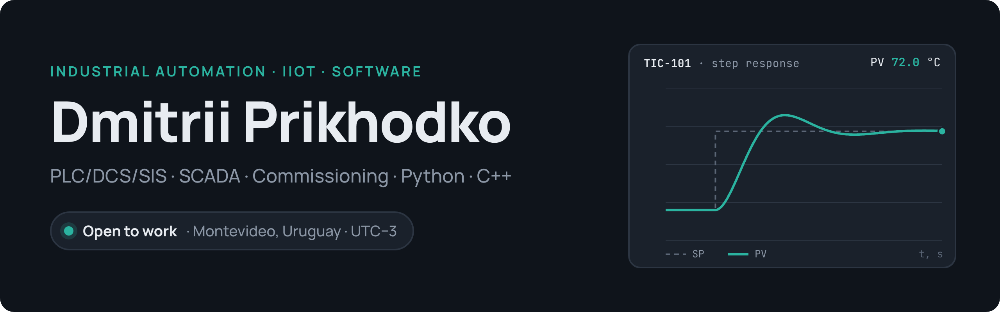

  

  

## About

Engineer with **5+ years** of experience bridging OT and IT in oil & gas, nuclear and thermal power. I commission control systems on operating plants and build the software around them: real-time data services, digital twins and integrations between field devices and IT systems.

I enjoy solving problems on site, working side by side with operations and maintenance, and leaving systems well documented. I use AI coding tools (Claude Code, Codex) to build faster, and I verify and test every result.

<table>
  <tr><td><b>Location</b></td><td>Montevideo, Uruguay (UTC−3)</td></tr>
  <tr><td><b>Focus</b></td><td>Industrial automation · Industrial IoT · Backend for industry</td></tr>
  <tr><td><b>Open to</b></td><td>On-site, hybrid and remote roles</td></tr>
  <tr><td><b>Languages</b></td><td>Russian (native) · English (professional) · Spanish (learning)</td></tr>
  <tr><td><b>Education</b></td><td>MSc, Thermal Power Engineering (with honors)</td></tr>
</table>

## What I work on

<table>
  <tr>
    <th width="33%">Industrial automation</th>
    <th width="33%">Industrial IoT</th>
    <th width="33%">Backend</th>
  </tr>
  <tr valign="top">
    <td>PLC / DCS / SIS application software IEC 61131-3 (ST, FBD) SCADA and HMI extensions SAT / FAT, loop and I/O checks Technical documentation</td>
    <td>MQTT · OPC UA · Modbus · IEC 61850 Digital twins Time series: InfluxDB, Grafana Sensor data acquisition Microcontrollers</td>
    <td>Python · C++ gRPC · WebSocket · microservices Docker · Linux PostgreSQL · MongoDB Unit and automated tests, Jenkins CI</td>
  </tr>
</table>

## Selected work

- **2,500+ field signals** verified during SAT/FAT on refinery units (diesel hydrotreating, atmospheric-vacuum distillation), including SIS/ESD validation with the plant in operation.
- **~25% faster** delivery of new pipeline automation projects thanks to a reusable IEC 61131-3 module library (4 → 3 weeks).
- **Digital twin of a thermal power plant:** ODE-based process model, virtual PLC with 4 cascaded PID loops, MQTT / gRPC / OPC UA, Docker.
- **In-house FBD-based DSL** that lets engineers configure control logic without writing code.
- **C++ backend test automation** for a video analytics platform: unit and automated tests, Jenkins CI, WebSocket services on Linux.
- **CFD of VVER steam generators** (ANSYS CFX), validated against PIV/LDV measurements.
- **+12% yield** on an electroplating line after automation that took an operator out of a toxic environment.

## Tech stack

**Industrial automation** 

**Industrial IoT** 

**Software** 

**Engineering and simulation** 

**AI-assisted development** 

**Also maintaining code in** 

## GitHub activity

  
  

  

## Contact

  

